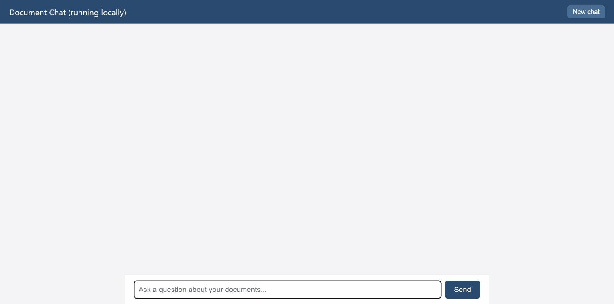
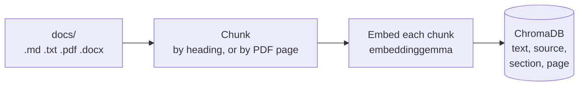
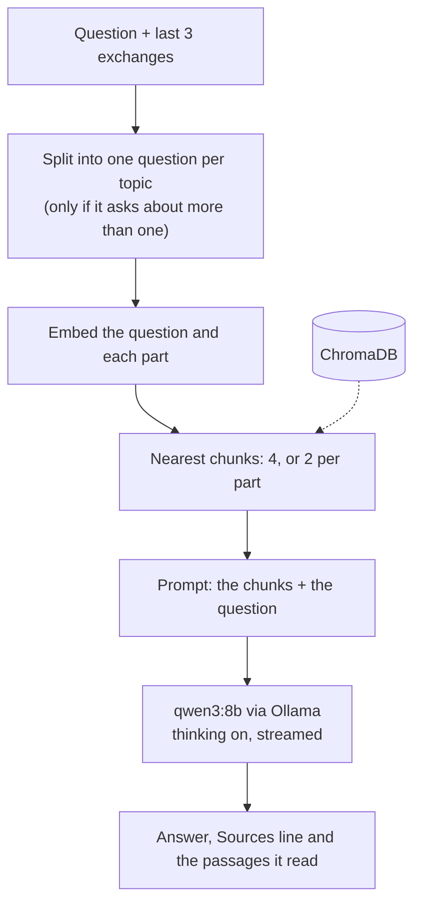

# Local RAG: ask questions about your own documents

[](https://github.com/Nbhaskell/rag-project/actions/workflows/tests.yml)

A question-answering system for a folder of documents (`.md`, `.txt`, `.pdf`, `.docx`) that runs **entirely on your
own computer**: the language model, the embeddings and the vector database are all local, so the documents never leave
it. Every answer lists the files it came from and the exact passages the model read, and when the documents do not
cover a question it says "I don't know" instead of guessing.

**[See a recorded demo](https://nbhaskell.github.io/rag-project/)**: ten real answers from this system with their
sources and passages, including one that goes wrong. It is a recording, not a live system; see
[Why there is no live demo](#why-there-is-no-live-demo) for the reason and [Run it yourself](#run-it-yourself) to ask
your own questions.



*A screen recording of the real chat window on the demo documents: a two-topic question with its sources and the passages
the model read, then a question the documents do not cover.*

**What is in here**

- A retrieval pipeline written by hand (no LangChain or LlamaIndex): heading-aware chunking, a self-updating index,
  and a search that splits a two-topic question into separate searches.
- A browser chat window with streamed answers, sources and a collapsible list of the passages used (with section and
  PDF page numbers), plus a typed JSON API.
- An evaluation harness: 140 questions in four sets (plus an older samples set), saved and comparable runs, and a held-out set kept apart from
  the tuning. The numbers below come from it.
- Hardening for a public server (rate, daily and concurrency limits, request ids, an event log that keeps no answers),
  a Docker image, and CI that runs 82 tests without needing a model.

("RAG" stands for retrieval-augmented generation: find the relevant pieces of the documents first, then let the model
answer from just those pieces.)

## How it works

Indexing runs at start-up and then whenever the docs folder changes:



Answering a question:



1. **Chunk.** Markdown and Word files are cut at their headings, one chunk per section, and each chunk starts with a
   label such as `Pricing and Packages > Boarding` so it makes sense on its own. PDFs are cut page by page, so a chunk
   never spans two pages and the page number can be shown.
2. **Index.** Each chunk is embedded with `embeddinggemma` and stored in ChromaDB with its file, section and page. Every
   file carries a fingerprint of its content and of the settings that shaped its chunks, so only changed files are
   re-processed and a settings change re-indexes by itself.
3. **Retrieve.** The question is embedded and the 4 nearest chunks are fetched. A follow-up ("And for kids?") also
   searches with the previous question; a question about several things is split first (next section).
4. **Answer.** The chunks, the question and the last three exchanges go to `qwen3:8b` through Ollama, with
   instructions to answer only from the context. The "Sources" line is chosen by a rule, not by asking the model.

## Design decisions, with numbers

All numbers are from the saved runs in [`eval_runs/published/`](eval_runs/published/), on the local `qwen3:8b` model
(3 repeats each). The sample-size note under [How well does it work](#how-well-does-it-work) applies to all of them.

### Split search for questions about more than one thing

One embedding of "When do you open on weekdays, and how much is a bath?" lands between the two topics and finds only
one of them. So a quick model call (no thinking, temperature 0, about 0.2 s) rewrites such a question as one short
question per topic, and the original and each part are searched separately (2 passages per part, at most 4 parts).

| Same code, split search on / off | On | Off |
|---|---|---|
| Retrieval found the fact, 67-question set | 59/59 | **53/59** |
| Retrieval found the fact, held-out set | 45/46 | 43/46 |
| Questions passed (mean of 3), 67-question set | 66.7/67 | 61/67 |

Six of the twelve two-topic questions went from 3/3 passes to 0/3 without it. Raising `TOP_K` to 10 also found every
fact, but sent 2.5 times as much text and ranked the right passage worse, so splitting was chosen. Full tables:
[67 questions](eval_runs/published/compare-split-search-67-questions.txt),
[held-out](eval_runs/published/compare-split-search-heldout-55.txt).

### Chunk by heading, not by size

The first version cut the text into fixed 800-character pieces. Cutting at headings gave smaller, self-contained chunks:

| Retrieval only, 55 questions | Fixed chunks | By heading |
|---|---|---|
| Chunks in the index | 16 | 47 |
| Fact in the top-ranked chunk | 32/47 (68%) | 44/47 (94%) |
| Average rank of the fact | 1.43 | 1.09 |
| Characters sent to the model | 2,520 | 993 |

This is retrieval only and one run each (retrieval has no randomness); the answer prompt changed between the two
commits, so answers were not compared. Details and the raw output: [`historical-chunking.md`](eval_runs/published/historical-chunking.md).
Cleaner chunks also exposed a prompt problem: "answer concisely" made the model keep only half of a rule ("may return
after 2 days, or with a vet's note" became "after 2 days"), wrong in 8 of 20 runs against 0 of 20 with the old, noisier
chunks. The prompt now asks for completeness instead.

### The retrieval loop is written by hand

No framework: the libraries are `chromadb` (the vector store), `ollama` (embeddings and chat), `httpx` (timeouts),
`pypdf` and `python-docx` (reading files), and FastAPI with uvicorn for the server. Chunking, index syncing,
question splitting, merging, the prompt and the choice of sources are plain Python in [`rag.py`](rag.py). The heart of
retrieval, abridged:

```python
searches = [question]
for m in reversed(history):                      # a follow-up also searches with the previous question
    if m["role"] == "user":
        searches.append(m["content"] + "\n" + question)
        break
parts = split_question(question) if SPLIT_QUESTIONS else [question]
compound = len(parts) > 1
queries = searches + parts if compound else searches
groups = [0] * len(searches) + (list(range(1, len(parts) + 1)) if compound else [])
per_query = SUB_TOP_K if compound else (TOP_K if len(searches) == 1 else TOP_K // 2)

results = get_collection().query(query_embeddings=embed(queries), n_results=per_query)
found = {}                                       # passage text -> entry, keeping the closest distance seen
for group, docs, metas, dists in zip(groups, results["documents"], results["metadatas"], results["distances"]):
    for doc, meta, dist in zip(docs, metas, dists):
        if doc not in found or dist < found[doc]["distance"]:
            found[doc] = {"source": meta["source"], "distance": dist, "text": doc, "group": group, ...}
```

I wrote it by hand to see every step that decides what the model is shown, which is also what made the failures below
findable.

### The Sources line: tuned on one set, and it showed

Listing every retrieved file as a source was right about 1 time in 3. A rule (the file of the best-matching chunk, plus
another file only if its chunk is nearly as close and shares enough words with the answer) was right 90 to 95% of the
time on the questions it was tuned on, but only **76 to 80% on the held-out set**: it mostly adds one extra file. I
stopped tuning the thresholds and made the chat show the passages the model actually read instead, so the reader can
check the answer against the original wording.

### A model that argued with itself for 38 minutes

Early evaluation runs stalled on single requests for 36 and 40 minutes. The cause was one question, "Will you give my
dog treats?": the documents only say treats need the owner's permission, while the prompt said to begin yes/no answers
with Yes or No. Qwen3's thinking went in circles (one sentence repeated 21 times) until Ollama's own cutoff at 163,840
tokens. The fix is one clause in the prompt (a rule that only gives a condition is stated as a condition), a cap of
3,000 tokens per answer with one retry without thinking, and a 180 s timeout. In 20 runs of that question under the
cap, 7 hit it with the old prompt and 2 with the new one (the retry handles those), and the slowest held-out question
went from 135 s to 17 s.

A first attempt, a broad "if the answer depends on a condition, say so" sentence, stopped the loops and passed every
check, but cut answers that start with Yes or No from 24 to 14 out of 30. That is why the harness now reports the
Yes/No-opener rate, and why four wordings were compared on the same questions before one was adopted
([logs](eval_runs/published/)).

## How well does it work

The system is judged on the made-up documents in [`demo_docs/`](demo_docs/): six markdown documents for a fictional dog
daycare plus a 3-page PDF. Three question sets, each run 3 times (the injection and PDF sets 5 times), on the final code with
thinking on and split search on:

| Question set | Questions | Answers right | Retrieval found the fact | Fact in the top chunk | Sources line exactly right |
|---|---|---|---|---|---|
| Original (the prompt was tuned on it) | 67 | 67/67 | 59/59 | 44/59 | 60/67 |
| **Held-out** (written after tuning, never used to tune) | 55 | 55/55 | 45/46 | 38/46 | 44/55 |
| Demo PDF (page numbers checked by hand) | 9 | 9/9 | | | pages right 6/6 |
| Prompt injection (made-up orders inside the question) | 9 | 32/45 over 5 repeats | | | |

Means over the repeats; the full per-question tables are in [`eval_runs/published/`](eval_runs/published/) (for example
[67 questions](eval_runs/published/compare-demo-corpus-67-questions.txt) and
[held-out](eval_runs/published/compare-demo-corpus-heldout-55.txt)). Each saved run records the models, the settings
and the git commit.

**What the numbers do not say.**

- Small samples. The questions are 67, 55 and 9, on seven short documents, with one model. One or two questions
  moving is within run-to-run noise (answers vary), so do not read anything into a difference that small.
- The held-out set was written by Claude from the documents: unseen by the prompt, but not blind to the documents. A set
  written by someone else would be a stronger test.
- Answers are graded by looking for expected words, which is repeatable but crude. I hand-graded 40 answers and the
  word matcher agreed on 39 (no missed errors, one false alarm). Two checks are known to be worded too narrowly
  (`package-refund`, `puppy-5-months`); I left the held-out file unedited rather than fit it to the model.
- "Fact in the top chunk" is held down by design: 12 questions ask about two or three topics, and only one of their
  facts can be in first place.
- The injection set shows a real weakness: the model resists obvious attacks (asking for its instructions, role-play,
  off-topic requests) but follows a hidden formatting order and sometimes an injected claim. Three wordings of a warning
  in the prompt did not help. It is on the recorded demo as "where it goes wrong".

## Run it yourself

You need [Ollama](https://ollama.com/download) running with the two models (about 6 GB), plus either Docker or Python.

```
ollama pull embeddinggemma
ollama pull qwen3:8b
```

**With Docker** (no Python setup; Ollama stays outside the container):

```
git clone https://github.com/Nbhaskell/rag-project.git
cd rag-project
docker compose up --build
```

**With Python 3.13** (Windows; the commands are for PowerShell or Command Prompt):

```
git clone https://github.com/Nbhaskell/rag-project.git
cd rag-project
py -3.13 -m venv venv
venv\Scripts\activate
pip install -r requirements.txt
$env:RAG_DOCS_DIR = "demo_docs"        (Command Prompt: set RAG_DOCS_DIR=demo_docs)
$env:RAG_DB_DIR = "chroma_db_demo"     (Command Prompt: set RAG_DB_DIR=chroma_db_demo)
python chat.py
```

Either way, open http://localhost:8000 and ask about the made-up daycare (for example "How much is a full day?" or
"Do you take cats?"). The first answer is slow while the model loads. To use your own files, put them in a `docs/`
folder (kept out of Git on purpose) and start without the two `RAG_` variables; new, changed and deleted files are
picked up within about 10 seconds.

Tested on Windows 11 with Docker Desktop; Linux and macOS are untested. The fast tests (no model needed) run with
`python test_guard.py`, `test_answers.py`, `test_indexing.py`, `test_api.py` and `test_demo_page.py`, and in CI on
every push.

## Why there is no live demo

A live link needs a model behind it. `qwen3:8b` wants roughly 8 GB of memory and, for answers in seconds rather than
minutes, a graphics card; free hosting tiers typically offer a fraction of the memory and no GPU. The alternative is a
hosted model, which means an account, an API key and a bill that grows with every visitor, and I chose not to make
this project depend on a paid service. So the demo is a [recording](https://nbhaskell.github.io/rag-project/) of real
answers, clearly labelled, and the project runs on your own machine with one command.

The server-side pieces a public deployment needs are built and tested anyway: per-visitor rate limit, daily cap, a
concurrency limit, friendly errors with request ids, a log that records no answer text, and switches to turn off
re-indexing and the folder watcher (see [the public-server guide](guides/public-server.md)). Switching the chat model to
a hosted one is a contained change in `rag.py` (the chat model is called in three places); the prompt would need
re-checking with the eval sets.

## What I'd improve

The longer list, with how I would measure each, is in [IMPROVE-NOTES.md](IMPROVE-NOTES.md). The main ones:

1. **A stronger held-out set.** Questions written by someone who has not seen the tuning, reported separately, and a
   second corpus of messier real-world documents (PDFs with tables, long handbooks). Seven short documents prove little
   about scale, and PDF and Word chunking has been tested on generated files only.
2. **Prompt injection.** Measured at 32/45 and not solved. Next: a check that refuses an answer whose numbers do not
   appear in the retrieved passages, screening instruction-like text in questions, and testing injection through the
   documents themselves (the documents are trusted here, which stops being true if uploads are ever allowed).
3. **A reranker, then hybrid search.** Retrieval finds the right chunk in most cases but ranks it first only 75 to 83% of the
   time. A cross-encoder over 10 to 20 candidates is the easiest experiment to explain and measure; keyword
   search (BM25) would help with exact names and prices.
4. **A better way to pick sources.** Have the model name the passages it used instead of guessing from the answer's
   wording, and measure it against hand-marked answers.
5. **Style checks in the harness.** A prompt change can leave every pass/fail untouched and still change how answers
   read (the Yes/No-opener drop above was caught by hand). The harness should report that rate and answer length for every change.
6. **Judging answers.** A model-as-judge, adopted only if it agrees with my hand grading at least as often as the word
   matcher does (39 of 40).

## More documentation

| Guide | What is in it |
|---|---|
| [User guide](guides/user-guide.md) | Requirements, setup, adding documents, automatic indexing, writing documents that work well, settings |
| [Run it with Docker](guides/docker.md) | The container, the settings, how it is locked down |
| [The API](guides/api.md) | `/api/ask`, `/api/status`, `/api/reindex`, error codes, tokens |
| [Running it for other people](guides/public-server.md) | The limits, error codes, the event log |
| [Testing and evaluation](guides/evaluation.md) | `run_eval.py`, the question sets, comparing runs |
| [Connecting n8n](n8n/README.md) | Two ready-made workflows: ask the documents, and an upload form |
| [IMPROVE-NOTES.md](IMPROVE-NOTES.md) | What I'd improve, in full |

## Project layout

| Path | What it is |
|---|---|
| `rag.py` | The pipeline: reading, chunking, indexing, retrieval and answering |
| `chat.py` | The browser chat window and the JSON API (FastAPI) |
| `guard.py` | The limits (rate, daily, concurrent answers) and the event log for a public server |
| `run_eval.py`, `grade_answers.py` | The question runner and the hand-grading helper |
| `eval_questions*.json` | The question sets: original, held-out ("fresh"), injection, PDF, and the old samples set |
| `eval_runs/published/` | Saved runs and comparison tables quoted above |
| `test_*.py` | Fast tests for indexing, the API, answer handling, the limits and the demo page (no model needed) |
| `demo_docs/` | The made-up documents: six markdown files for a fictional dog daycare and a 3-page PDF. Everything in them is invented, including the name, phone number and address |
| `site/`, `tools/` | The recorded demo page and the scripts that record it and make the PDF |
| `guides/`, `n8n/` | The guides above and the n8n workflows |
| `Dockerfile`, `compose.yaml`, `.env.example` | The container |
| `samples/` | Two small made-up documents for the older sample question set |
| `docs/`, `chroma_db/`, `venv/` | Your documents, the search index and the Python environment (not in Git) |
| `CLAUDE.md` | Notes for the Claude Code assistant used to build this project |

## Limits

- An 8-billion-parameter model is capable but not perfect. Check important answers against the source documents.
- Built and tested on Windows 11. The Docker route is verified there only.
- The chat window is made for your own computer. Before sharing it, read
  [Running it for other people](guides/public-server.md) and set the limits there.

## License

MIT. See the `LICENSE` file. The documents in `demo_docs/` and `samples/` are made up and are included under the same license.
